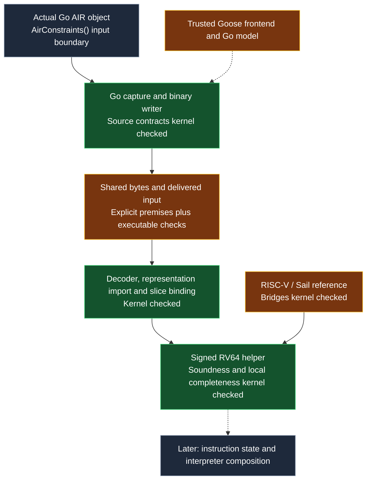

# verified-air-extraction

Source-linked AIR extraction and signed RV64 DIV/REM proofs for Lineth ZkC, in Lean 4.

## Main result

For the captured AIR instance, an accepted signed 64-bit helper tuple exists
**if and only if** its quotient and remainder are the specified RISC-V results.
The proof covers every operand pair, division by zero and signed overflow.
It checks raw output limbs, not only their decoded value.

This is the artifact-bound theorem, written as a Lean example:

```lean
import DivRemFV.ExtractorBinding
open DivRemFV

example (source : CaptureSyntax.Artifact)
    (bounded : ∀ n ∈ source.words, n < 2^64)
    (same : CaptureSyntax.byteValues source.words = Replay.bytes.map UInt8.toNat)
    (a b : BitVec 64) (q r : Scalar × Scalar × Scalar × Scalar) :
    ArtifactBinding.Accepts source.toWire (encodeFour a.toNat) (encodeFour b.toNat) q r ↔
      q = encodeFour (signedQuotient a b).toNat ∧
      r = encodeFour (signedRemainder a b).toNat :=
  ExtractorBinding.component source bounded same a b q r
```

- `bounded`: each serialized word fits in 64 bits. The source writer contract derives this property.
- `same`: the captured bytes equal the bytes replayed in the arithmetic proof. The executable join checks their identity.

[ExtractorBinding.raw_component](proofs/divrem/DivRemFV/ExtractorBinding.lean)
also quantifies over raw input limbs and proves their canonical encoding.
The actual DIV and REM lookup-port theorems return the correct result in the
caller columns. Their scope ends before register writeback.

Soundness needs range-safe table entries. Local completeness constructs the
canonical tables and an honest helper witness. It does not assert completeness
for every choice of range-safe tables or for a whole interpreter execution.

| Part of the chain | Assurance | Boundary |
|---|---|---|
| Go capture and binary writer | Source contracts checked in Lean / Perennial | Partial correctness on the supported input graphs; Goose translation, Go models, layouts and function resolution are trusted. |
| Source-to-replay byte join | Portable definitions compared; delivered bytes checked by an executable | Two Lean builds, not one composed kernel theorem; host execution and input delivery remain trusted. |
| Decoder, representation import and selected slice | Kernel-checked decoding, semantic preservation between defined representations, static data and interface checks | Adequacy of the defined AIR semantics to ZkC's evaluator is not formally proved. |
| Signed helper | Kernel-checked soundness and local completeness; raw input and output canonicality | One signed RV64 helper; actual call-port soundness, without instruction dispatch or register-state correctness. |
| RISC-V reference | Kernel-checked agreement with the published Sail Lean DIV/REM model | ISA interpretation and the original Sail-to-Lean generation remain reference assumptions. |
| Production and approval | Outside this PoC | Backend constraint enforcement, deployed verifier identity and independent approval are not established. |

`TypeAssumptions` and `FuncUnfold` are Perennial interfaces for type information
and function resolution in the Go model. Their use is standard in that framework;
the premises must still hold. A clean axiom audit does not discharge them.

## Architecture



Green marks the named kernel-checked claim under its premises. Amber marks a
trusted connection or executable check. Grey marks an input or later work.
Lineth's embedded `.zkc` source is compiled before capture. The compiler's
correctness is not assumed by the helper arithmetic proof: that proof checks the
resulting constraints against the specification.

The instance contains 99 modules and 12,885 constraints. Its 10,176,360 bytes
are replayed as data. The arithmetic slice has 548 constraints, eight dynamic
modules and nine range tables. The final claim covers `divMod_64_ss`.

The [walkthrough](docs/walkthrough.md) explains limb encoding, field-to-integer
lifting, division uniqueness, sign correction and witness construction.
The [audit guide](docs/audit-guide.md) gives the exact review order and endpoints.

## Relation to other work

This PoC uses established formal verification methods: source-level program
contracts, checking generated artifacts, and kernel-checked proofs. It checks
properties of ZkC's output against a specification; it does not prove the ZkC
source-to-AIR compiler transformation correct.

| Work and cited result | Extraction | Proved result | Scope |
|---|---|---|---|
| [SP1 Hypercube, 2025](https://blog.succinct.xyz/nethermind-lean/) | Rust AIR extraction is explicitly trusted. | Opcode soundness against Sail; see the [scope analysis](https://zkevm.ethereum.foundation/blog/sp1-fv). | 62 RV64 opcodes reported; the scope analysis describes the limits. |
| [OpenVM RV32IM, February 2026](https://blog.openvm.dev/fv) | Nethermind's Plonky3 extraction tooling is open source; the announcement does not claim that the extraction tooling itself is verified. | Constraints imply Sail opcode behavior; execution and memory consistency are also covered. | 45 RV32IM opcodes; backend arguments are assumed. |
| [zkLean, March 2026](https://www.galois.com/articles/zklean-a-dsl-for-zk-statement-verification) | Lean circuit DSL, with Jolt extraction and LLZK integration. | Compositional circuit soundness examples, including SHA-3 and lookup tables. | Circuit components and frontend statements. |
| This PoC | Actual Go capture and writer bodies have partial-correctness contracts under the assumptions above. | Helper soundness and local completeness, plus canonical raw limbs and actual call-port soundness. | One signed RV64 helper and its dependency slice. |

Unlike the cited zkVM results, the code that extracts and serializes the AIR here
has its own source contracts. The ZkC compiler, the Goose frontend and the join
between the two Lean builds remain trusted.

These rows describe the cited results, not every later release or a ranking of
whole systems. The reusable extraction boundary is the focus of this showcase;
DIV/REM is the worked component.

## Rebuild

Linux x86-64 is supported. Install Git, Python 3, curl, tar, zstd and a C/C++
toolchain. From the repository root:

```bash
python3 bootstrap.py
bash build.sh --clean
```

Bootstrap installs checksum-pinned Go 1.27.1, Lean 4.30.0 and Lean 4.34.1 inside
`work/`, and fetches pinned dependencies and mathlib’s precompiled cache.
It does not rebuild every third-party library from source. `--clean` clears both project proof
caches; it retains third-party caches. Do not run concurrent builds in one
checkout. The source mutation test restores its changes before the final audit.

For a fresh container, with no project or dependency caches:

```bash
docker build -t verified-air-extraction .
docker run --name verified-air-check --cpus=4 --memory=24g --memory-swap=40g \
  verified-air-extraction bash -lc 'python3 bootstrap.py && bash build.sh --clean'
docker cp verified-air-check:/workspace/proofs/divrem/artifacts/linux ./build-evidence
```

The base image is pinned by digest. Podman can run the same commands. The
container needs network access to fetch public pinned dependencies. Host swap
and container memory limits must be set outside the image.

A reference Linux x86-64 run on 12 November 2026 passed all **123 steps**,
including both proof builds, full replay, the README example, axiom audits and
source mutation rejection/restoration. The runner regenerates its reports under
`proofs/divrem/artifacts/linux/`. Run reports are not checked into this repository.

Measured configuration: four CPU cores of quota, a 24 GiB container RAM limit
and a 16 GiB swap limit. Bootstrap and the full build took **41 minutes 11 seconds**.
Peak container memory was **21.1 GiB**; peak swap use was **2.6 GiB**. Recommend
**32 GiB RAM and 16 GiB available swap** for a comparable run. This is a tested
configuration, not a measured minimum. Downloads affect elapsed time. Use `python3 scripts/container_check.py` inside the container to collect limits,
aggregate peaks and elapsed time for a new run. Reference validation used Podman 5.8.9.
No hosted full CI run is claimed.

## Evaluator cross-check

The finite Lean checker has a kernel-checked equivalence to `ConstraintsHold`.
The differential harness compares each selected constraint with ZkC's upstream
checker, using canonical tables and synthetic range-safe variants. It includes accepted honest witnesses,
cell mutations, random traces and targeted limb / selector cases. This is test
evidence for the selected fragment, not a proof of evaluator equivalence.
The deterministic corpus has **3,341 traces**, including 256 honest witnesses
and eight range-safe table variants. The reference run compared **1,830,868
individual constraint verdicts** with no disagreements. All 256 honest cases
with canonical tables passed. New runs write their counts and results to
`proofs/divrem/artifacts/trace-semantics-summary.json`.
Every selected constraint has both a passing and a failing case in the corpus.

Duplicate entries and removal of an unused entry preserve the honest witness.
Removal of a required entry, an empty required table, and wrong remainders
under the changed tables reject it. Both evaluators receive the same table
contents; ZkC uses isolated schema copies because it reads static tables there.
The captured AIR and its canonical binding checks stay unchanged. These cases
test range-only soundness; they do not extend completeness to arbitrary tables.

A changed cell need not make a trace invalid: it may affect inactive or
irrelevant data. The test requires the evaluators to agree, and requires all
honest cases to pass. It does not claim that every cell mutation must fail.

## Maintenance and reuse

After relevant changes, regenerate the AIR and certificates and recheck the
same specification. Capture changes require new source proofs; changed IDs,
column layouts or polynomial structure can require proof repair. Hashes record
identity and detect changes during a run. They do not approve a weaker target.

The source tree has 383,312 Lean lines. Of these, 308,932 (about
81%) are full-artifact replay files. The other 74,380 lines include generated
arithmetic proofs, translated Go, reusable libraries and supporting components.
These counts describe stored source, not engineering effort.

Capture, wire encoding, decoding, replay and representation import are reusable
within the supported AIR fragment. Range, field-lifting, word encoding and lookup
lemmas support new component proofs. Slice selection and semantic contracts must
still be checked for each component. Automatic tolerance of arbitrary refactors
is not claimed.

## Next steps

1. Bring both proof sets onto one Lean version, then compose the source contract,
   decoder and component theorem. This needs more than a version change; host
   execution and delivery remain separate obligations.
2. Add an instruction contract for DIV and REM: decode, register reads, helper
   call, writeback and PC update.
3. Reduce dependence on numeric module, column and selector IDs to limit proof
   repair after equivalent recompilations.
4. Establish backend enforcement and the identity of the deployed verifier.

## Review material

- [Specification](docs/spec.md) and [self-audit](docs/self-audit.md).
- [Build driver](proofs/divrem/LinuxBuild.py), including required audits and mutation checks.
- [Source-capture proof guide](proofs/capture/README.md).
- [Talk notes and expansion plan](docs/talk/presentation.md).
- [Third-party notices](THIRD_PARTY.md) and [license](LICENSE).
